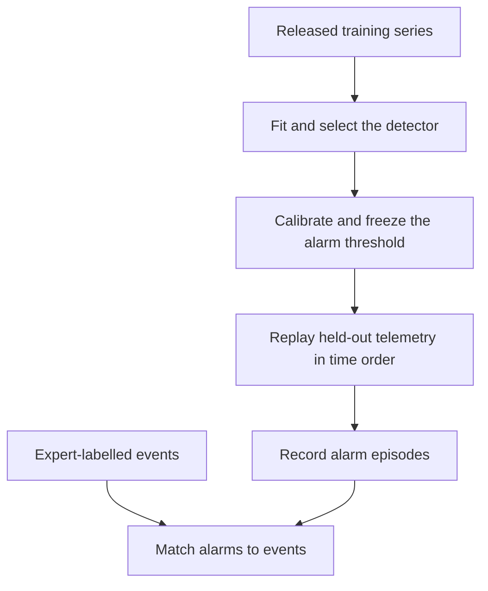

# Spacecraft anomaly detection

**Can a detector catch more spacecraft anomalies without sending more false alarms?**

A replay study using telemetry from NASA’s **SMAP satellite** and the **Curiosity rover**. The first experiment follows one power channel, `P-1`, from a 250-reading history to an alarm that can be checked against an expert-labelled event.

| Mission archive | Published benchmark | Pilot |
| :--- | :--- | :--- |
| SMAP · Mars Science Laboratory | 82 channels · 105 labelled events | SMAP P-1 · 8,505 test readings · 3 contextual events |

### What makes a reading unusual?

| Detector | The question it asks |
| :--- | :--- |
| **Level alarm** | Is this reading far from the channel’s usual level? |
| **Persistence** | How much has the reading changed since the previous step? |
| **LSTM forecast** | Given the last 250 readings and command history, how far is this reading from its forecast? |

### From telemetry to evidence

**Decision rule.** The forecast earns a claim of improvement if it catches a larger share of events than both baselines with no increase in false alarms per 1,000 readings. Detection delay and time spent in alarm show what those numbers mean for someone monitoring a channel.

### Research log

- [x] Define the hypothesis, calibration policy and event-matching rules.
- [ ] Reconcile the data release and record file hashes.
- [ ] Verify the P-1 pilot and freeze the experiment.
- [ ] Evaluate both missions and publish the event ledger.

[Read the research protocol](docs/research-protocol.md) · [Explore the source dataset](https://github.com/khundman/telemanom) · [Read the original paper](https://doi.org/10.1145/3219819.3219845)

> **Interpretation limit**  
> The released telemetry was scaled using test-set extrema. This study evaluates replay on those released arrays. The benchmark counts above describe the source archive. Model performance is still unmeasured.
