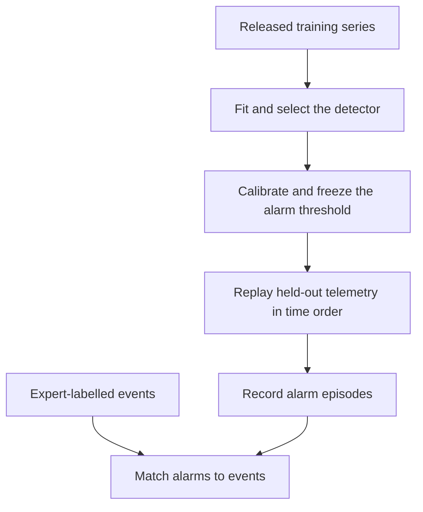

# Spacecraft anomaly detection

**Can a detector catch more spacecraft anomalies without sending more false alarms?**

A replay study using telemetry from NASA’s **SMAP satellite** and the **Curiosity rover**. The first experiment follows one power channel, `P-1`, from a 250-reading history to an alarm that can be checked against an expert-labelled event.

| Mission archive | Published benchmark | Pilot |
| :--- | :--- | :--- |
| SMAP · Mars Science Laboratory | 82 channels · 105 labelled events | SMAP P-1 · 8,505 test readings · 3 contextual events |

## Current results

The frozen NASA benchmark is complete across **78 channels and 100 labelled events**. The direct LSTM detected **90 events** and raised **2,148 unmatched alarm episodes**. The persistence baseline detected **78 events** with **1,401 unmatched alarms**, so the LSTM missed the overall criterion of improving detection without increasing alarms.

- [NASA benchmark and follow-up results](reports/nasa-results.md)
- [Reproduce the NASA experiments and resume the residual screen](docs/nasa-follow-up-experiments.md)
- [Residual screen checkpoint](reports/residual-screen-checkpoint.json), audited through **30 of 78 channels**
- [Independent ESA Mission1 pilot](experiments/esa_mission1/README.md), with synthetic checks complete and real-data evaluation pending

The sections below document the original P‑1 pilot and data intake.


### What makes a reading unusual?

| Detector | The question it asks |
| :--- | :--- |
| **Level alarm** | Is this reading far from the channel’s usual level? |
| **Persistence** | How much has the reading changed since the previous step? |
| **LSTM forecast** | Given the last 250 readings and command history, how far is this reading from its forecast? |

### From telemetry to evidence



**Decision rule.** The forecast earns a claim of improvement if it catches a larger share of events than both baselines with no increase in false alarms per 1,000 readings. Detection delay and time spent in alarm show what those numbers mean for someone monitoring a channel.

### Data admitted to the experiment

| Mission | Eligible channels | Eligible events | Eligible test readings |
|---|---:|---:|---:|
| SMAP | 52 | 66 | 406,699 |
| Curiosity (MSL) | 26 | 34 | 66,133 |
| **Total** | **78** | **100** | **472,832** |

The Kaggle mirror has 82 train/test pairs. Its labels match the [pinned source CSV](https://github.com/khundman/telemanom/blob/2e6c5b6c3558e7835601519b7bdef37c649bdbdc/labeled_anomalies.csv) byte for byte. SMAP P-2 has two conflicting records, T-10 lacks a label record, and D-12 and T-9 have insufficient training history under the protocol. The [intake manifest](reports/intake.json) records the per-file hashes, splits and exclusions.

**P-1 pilot.** The two baselines calibrated on 431 training-file readings. Both produced four strict threshold exceedances on that same calibration block. Replaying its first 215 readings reproduced the corresponding smoothed scores exactly. These checks precede held-out evaluation.

To reproduce with Python and NumPy, download the [telemetry ZIP](https://www.kaggle.com/api/v1/datasets/download/patrickfleith/nasa-anomaly-detection-dataset-smap-msl) as `kaggle.zip` and the pinned CSV as `labeled_anomalies.csv`. Run from the repository root:

```sh
python scripts/intake.py --archive kaggle.zip --labels labeled_anomalies.csv --source https://www.kaggle.com/api/v1/datasets/download/patrickfleith/nasa-anomaly-detection-dataset-smap-msl --commit 2e6c5b6c3558e7835601519b7bdef37c649bdbdc --retrieved 2026-11-18 --output intake-replay.json
python scripts/pilot_baselines.py kaggle.zip
```

### Reproduce the P-1 pilot

Use the archive above with the CPU build of PyTorch 2.8.0 and NumPy. Run from the repository root with fresh paths for the checkpoint and report.

```sh
python -m unittest discover -s scripts -p 'test_event_scoring.py' -v
python scripts/pilot_lstm.py kaggle.zip --checkpoint p1.pt --output p1-run.json --threads 2
```

The training command reads only the P-1 training member. It selects a checkpoint on the chronological validation block and freezes the alarm threshold on the final calibration block.

**Frozen pilot.** Training stopped at epoch 28. The selected checkpoint (epoch 23) achieved validation MSE 0.02484. Its calibrated alarm threshold was 0.1725272. Removing future readings preserved all 215 prefix alarm decisions, and loading the checkpoint reproduced every calibration score. [Run report and freeze record](reports/p1-pilot.json) · [Pilot review](https://github.com/nisxl-s/spacecraft-anomaly-detection/pull/2)

### Held-out results on P-1

All three detectors saw the same 8,255 readings (indices 250–8,504). The LSTM detected the event beginning at 2,149 after 41 readings. Persistence detected the event beginning at 3,539 after 15 readings. All three missed the event beginning at 4,536.

| Detector | Events found | False alarms | False alarms per 1,000 | Readings in alarm |
|---|---:|---:|---:|---:|
| Level | 0/3 | 5 | 0.606 | 15 |
| Persistence | 1/3 | 17 | 2.059 | 23 |
| LSTM | 1/3 | 20 | 2.423 | 47 |

The LSTM matched persistence on event recall and produced three additional false alarms. It did not meet the prespecified superiority criterion on P-1. The overall hypothesis requires the two-mission evaluation. [Event ledger and score-file checksum](reports/p1-replay.json)

To reproduce with the exact frozen checkpoint (verify its SHA-256 against the pilot report), use the `intake-replay.json` generated above and fresh output paths. The replay checks the manifest’s SHA-256, so JSON formatting matters:

```sh
python scripts/replay_p1.py --archive kaggle.zip --manifest intake-replay.json --pilot reports/p1-pilot.json --checkpoint p1.pt --labels labeled_anomalies.csv --scores p1-scores.csv --report p1-replay.json
```

### Research log

- [x] Define the hypothesis, calibration policy and event-matching rules.
- [x] Reconcile the data release and record file hashes.
- [x] Verify and freeze the P-1 training-side pilot.
- [x] Replay all three frozen detectors on P-1 and verify the event ledger.
- [x] Evaluate both missions and report the frozen benchmark results.
- [x] Replay calibration-matched thresholds, threshold sweeps, capped alarms and two-reading confirmation.
- [ ] Finish and audit the residual forecast screen across all 78 channels.
- [ ] Complete independent evaluation on ESA Mission1.

[Read the research protocol](docs/research-protocol.md) · [Explore the source dataset](https://github.com/khundman/telemanom) · [Read the original paper](https://doi.org/10.1145/3219819.3219845)

> **Interpretation limit**  
> The released telemetry was scaled using test-set extrema. This study evaluates replay on those released arrays. The benchmark counts above describe the source archive. Performance results above apply to P-1 only.

## ESA research status

| Study | Result |
|---|---|
| [Mission 1 pilot](experiments/esa/esa-run/test-summary.json) | The calibration window had no eligible anomalies. The no-alarm fallback missed six test channel-events. |
| [Mission 1 frozen workload](experiments/esa/esa-extension/summary.json) | The residual LSTM detected 3/3 incidents and 14/18 channel-events. It emitted 16.00 episodes per 1,000 eligible channel-hours across 2009–2013. |
| [Adaptive thresholds](experiments/esa/esa-adaptive/comparison.json) | Monthly thresholds reduced workload to 3.08 episodes per 1,000 hours and retained 2/3 incidents. |
| [Mission ticket escalation](experiments/esa/esa-ticket/k3w6/comparison.json) | The selected rule detected 3/3 incidents by page and stayed within the paging budget in each development year. |
| [Independent Mission 2 transfer](experiments/esa/esa-mission2/summary.json) | Both paging policies met the yearly paging budget. The detector missed the single eligible incident and its four channel-events. |
| [Mission 2 native-range development trial](experiments/esa/esa-m2-diagnosis/range-trial/summary.json) | Hourly native range generated 333 test episodes and detected no channel-events. |

The ESA directories contain the experiment scripts, frozen settings and compact reports. Mission 1 paging parameters were selected on 2009–2013 development data. Mission 2 held-out results are independent of that selection. Follow-up diagnosis on the same Mission 2 incident is exploratory.

### Reproduce the ESA experiments

Use the ESA Anomaly Dataset v2 from [Zenodo](https://zenodo.org/records/15237121). Install Python, CPU PyTorch, NumPy and pandas. From the repository root set:

```sh
export PYTHONPATH="$PWD/experiments/esa_mission1:$PWD/experiments/esa/esa-run"
```

The Mission 1 runners expect the six verified channel archives and annotation CSVs in `experiments/esa/upload/`, plus the frozen fit and model artifacts in the experiment directories. These generated inputs, telemetry, and binary checkpoints are distributed separately. Run the experiment entry points in order from `esa-run` through `esa-ticket`; the ticket policy uses the sealed long-horizon replay. The Mission 2 protocol and entry points are under [esa-mission2](experiments/esa/esa-mission2/protocol.md), with the independent transfer ordered as training, frozen replay, annotation scoring, and audit.
