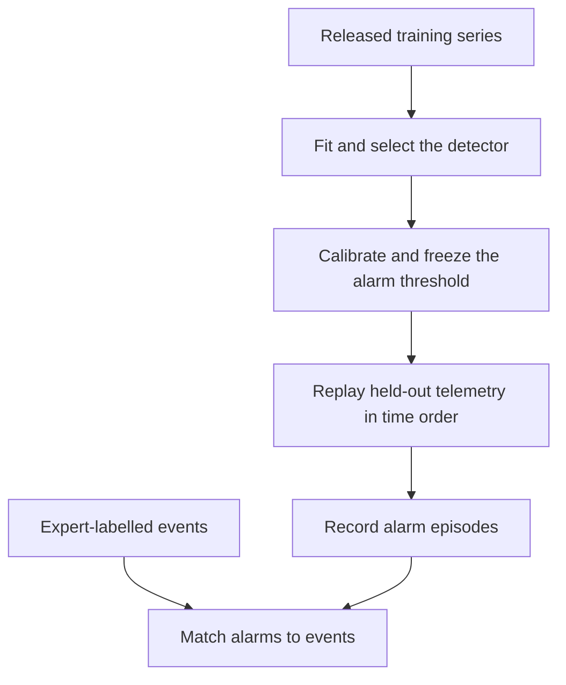

# Spacecraft anomaly detection

**Can a detector catch more spacecraft anomalies without sending more false alarms?**

A replay study using telemetry from NASA’s **SMAP satellite** and the **Curiosity rover**. The first experiment follows one power channel, `P-1`, from a 250-reading history to an alarm that can be checked against an expert-labelled event.

| Mission archive | Published benchmark | Pilot |
| :--- | :--- | :--- |
| SMAP · Mars Science Laboratory | 82 channels · 105 labelled events | SMAP P-1 · 8,505 test readings · 3 contextual events |

### What makes a reading unusual?

| Detector | The question it asks |
| :--- | :--- |
| **Level alarm** | Is this reading far from the channel’s usual level? |
| **Persistence** | How much has the reading changed since the previous step? |
| **LSTM forecast** | Given the last 250 readings and command history, how far is this reading from its forecast? |

### From telemetry to evidence



**Decision rule.** The forecast earns a claim of improvement if it catches a larger share of events than both baselines with no increase in false alarms per 1,000 readings. Detection delay and time spent in alarm show what those numbers mean for someone monitoring a channel.

### Data admitted to the experiment

| Mission | Eligible channels | Eligible events | Eligible test readings |
|---|---:|---:|---:|
| SMAP | 52 | 66 | 406,699 |
| Curiosity (MSL) | 26 | 34 | 66,133 |
| **Total** | **78** | **100** | **472,832** |

The Kaggle mirror has 82 train/test pairs. Its labels match the [pinned source CSV](https://github.com/khundman/telemanom/blob/2e6c5b6c3558e7835601519b7bdef37c649bdbdc/labeled_anomalies.csv) byte for byte. SMAP P-2 has two conflicting records, T-10 lacks a label record, and D-12 and T-9 have insufficient training history under the protocol. The [intake manifest](reports/intake.json) records the per-file hashes, splits and exclusions.

**P-1 pilot.** The two baselines calibrated on 431 training-file readings. Both produced four strict threshold exceedances on that same calibration block. Replaying its first 215 readings reproduced the corresponding smoothed scores exactly. These checks precede held-out evaluation.

To reproduce with Python and NumPy, download the [telemetry ZIP](https://www.kaggle.com/api/v1/datasets/download/patrickfleith/nasa-anomaly-detection-dataset-smap-msl) as `kaggle.zip` and the pinned CSV as `labeled_anomalies.csv`. Run from the repository root:

```sh
python scripts/intake.py --archive kaggle.zip --labels labeled_anomalies.csv --source https://www.kaggle.com/api/v1/datasets/download/patrickfleith/nasa-anomaly-detection-dataset-smap-msl --commit 2e6c5b6c3558e7835601519b7bdef37c649bdbdc --retrieved 2026-11-18 --output intake-replay.json
python scripts/pilot_baselines.py kaggle.zip
```

### Reproduce the P-1 pilot

Use the archive above with the CPU build of PyTorch 2.8.0 and NumPy. Run from the repository root with fresh paths for the checkpoint and report.

```sh
python -m unittest discover -s scripts -p 'test_event_scoring.py' -v
python scripts/pilot_lstm.py kaggle.zip --checkpoint p1.pt --output p1-run.json --threads 2
```

The training command reads only the P-1 training member. It selects a checkpoint on the chronological validation block and freezes the alarm threshold on the final calibration block.

**Frozen pilot.** Training stopped at epoch 28. The selected checkpoint (epoch 23) achieved validation MSE 0.02484. Its calibrated alarm threshold was 0.1725272. Removing future readings preserved all 215 prefix alarm decisions, and loading the checkpoint reproduced every calibration score. [Run report and freeze record](reports/p1-pilot.json) · [Pilot review](https://github.com/nisxl-s/spacecraft-anomaly-detection/pull/2)

### Research log

- [x] Define the hypothesis, calibration policy and event-matching rules.
- [x] Reconcile the data release and record file hashes.
- [x] Verify and freeze the P-1 training-side pilot.
- [ ] Evaluate both missions and publish the event ledger.

[Read the research protocol](docs/research-protocol.md) · [Explore the source dataset](https://github.com/khundman/telemanom) · [Read the original paper](https://doi.org/10.1145/3219819.3219845)

> **Interpretation limit**  
> The released telemetry was scaled using test-set extrema. This study evaluates replay on those released arrays. The benchmark counts above describe the source archive. Model performance is still unmeasured.
